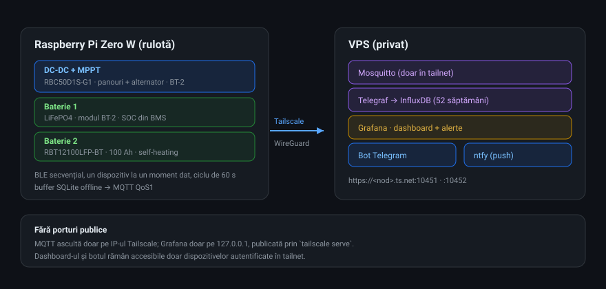

# Renogy Monitor — monitorizare energie pe Raspberry Pi Zero W

Monitorizează un încărcător Renogy DC-DC cu MPPT, o baterie cu modul BT-2 și o
baterie Renogy cu Bluetooth integrat, de pe un **Raspberry Pi Zero W**, și
trimite datele într-un stack privat pe un VPS: **MQTT → InfluxDB → Grafana**,
plus **bot de Telegram** cu raport zilnic și alarme.

Totul rulează **exclusiv prin Tailscale** — nu expune niciun port pe internet și
nu are nevoie de domeniu sau certificat cumpărat.



```text
┌─────────────── Pi Zero W (în rulotă) ───────────────┐
│ BLE (o conexiune pe rând, ciclu de 60 s)            │
│   ├─ DC-DC + MPPT   (BT-2)                          │
│   ├─ Baterie 1      (BT-2)                          │
│   └─ Baterie 2      (Bluetooth integrat)            │
│            ↓                                        │
│  buffer SQLite (offline) → MQTT QoS1                │
└──────────────────────┬──────────────────────────────┘
                       │ Tailscale (WireGuard)
┌──────────────────────▼──────────────────────────────┐
│ VPS                                                  │
│  Mosquitto → Telegraf → InfluxDB → Grafana           │
│  Bot Telegram  ·  ntfy (notificări push)             │
└──────────────────────────────────────────────────────┘
```

## Ce vezi

- **Grafana**: SOC per baterie, tensiune, curent, putere, temperaturi, celule,
  de unde se încarcă (panouri / alternator / priză), consum, producție azi și
  total.
- **Telegram**: aceleași date la cerere, raport zilnic automat la 09:00 și
  alarmă când o baterie scade sub 20%.

## Documentație

| Document | Cuprins |
|---|---|
| [docs/DEPLOY.md](docs/DEPLOY.md) | Ghid complet, pas cu pas, de la card SD la dashboard |
| [docs/HARDWARE.md](docs/HARDWARE.md) | Ce hardware e conectat, MAC-uri, registre, limite |
| [docs/TELEGRAM.md](docs/TELEGRAM.md) | Botul: instalare, comenzi, alerte |
| [docs/runbook.md](docs/runbook.md) | Operație zilnică: loguri, restart, depanare |
| [docs/protocol.md](docs/protocol.md) | Protocolul Modbus peste BLE |
| [PLAN.md](PLAN.md) | Arhitectura și fazele proiectului |

## Hardware folosit

| Element | Model | Rol |
|---|---|---|
| Calculator | Raspberry Pi Zero W Rev 1.1 (ARMv6) | citește BLE, trimite datele |
| Încărcător | Renogy **RBC50D1S-G1** (DC-DC + MPPT, 50 A) | panouri + alternator |
| Baterie 1 | LiFePO4 cu modul **BT-2** | BMS prin Bluetooth |
| Baterie 2 | Renogy **RBT12100LFP-BT** (100 Ah, self-heating) | BMS prin Bluetooth |

Detalii, inclusiv MAC-uri și hărți de registre: [docs/HARDWARE.md](docs/HARDWARE.md).

## Pornire rapidă (pentru cine are deja infrastructura)

```bash
# pe Pi
sudo systemctl status renogy-monitor
journalctl -u renogy-monitor -f

# pe VPS
ssh claude-server 'cd /opt/renogy && docker compose ps'
ssh claude-server 'cd /opt/renogy && docker compose logs -f telegram'
```

Ghidul complet: [docs/DEPLOY.md](docs/DEPLOY.md).

## Structura repo-ului

```text
pi/                 aplicația de pe Raspberry Pi
  src/renogy_monitor/
    ble/            transport BLE, sesiune, ajutor BlueZ (D-Bus)
    modbus/         cadre Modbus + hărți de registre
    cycle.py        ciclul de 60 s + deducerea surselor de încărcare
    buffer.py       buffer SQLite pentru perioade fără net
    uplink/mqtt.py  publicare MQTT QoS1 cu drenarea backlog-ului
    cli.py          `renogyctl` (scan / probe / sweep / run)
  deploy/           instalare, unit systemd, config exemplu
server/             stack-ul de pe VPS (Docker Compose)
  mosquitto/        broker MQTT
  telegraf/         MQTT → InfluxDB
  grafana/          dashboard + alerte provisionate
  telegram/         botul
  alertbridge/      webhook Grafana → ntfy
docs/               documentație
```

## Cerințe

- **Pi**: Raspberry Pi OS Lite 32-bit (armhf), Pi Zero W, card SD 16 GB+
- **VPS**: 1 vCPU, 1 GB RAM, 25 GB disk, Docker + Docker Compose
- **Tailscale** pe Pi, VPS și pe telefonul/laptopul tău
- **Bot Telegram** creat cu @BotFather

## Securitate

- niciun port public; MQTT ascultă doar pe IP-ul Tailscale, Grafana doar pe
  `127.0.0.1` și este publicată prin `tailscale serve` (HTTPS valid, tailnet only);
- secretele stau doar în `/opt/renogy/.env` (VPS) și `config.yaml` (Pi), ambele
  în afara git-ului;
- botul acceptă un singur chat, cel care trimite primul `/start`.

## Licență

MIT. Renogy este marcă a deținătorilor ei; proiectul nu este afiliat Renogy.
